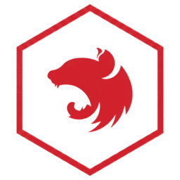

<p align="center"></p>

<h1 align="center">NestFactory</h1>

<p align="center">An IDE for NestJS. The fastest path from an empty folder to a running, documented, database-backed Nest API.</p>

NestFactory turns the Nest CLI, database setup and API tooling into visual, project-aware workflows. It understands modules, providers and injection rather than just text, and everything it writes is plain Nest code that builds and runs without it.

## Features

| Area | What it does |
| --- | --- |
| New project wizard | Wraps `nest new` (standard or monorepo, npm/pnpm/yarn, strict mode, lint) and adds config, JWT auth, Swagger and health-check starters. |
| Visual generators | Resource, controller, service, guard, pipe, interceptor, filter, DTO, gateway, module and more, with REST, GraphQL, microservice or WebSocket transports. Every file change is previewed as a diff, written as one step and undone with Ctrl Z. Output is identical to `nest g`. Team templates in `.nestfactory/templates/<schematic>` override the built-in ones. |
| Module graph | Imports, providers and exports views. Flags circular imports, missing providers, unimported modules and unregistered controllers before runtime, each with a one-click fix. Drag a provider onto a module to wire it. |
| Database manager | TypeORM, Prisma, Mongoose, MikroORM or Sequelize on PostgreSQL, MySQL, SQLite or MongoDB. Installs packages, writes the module config and `.env`, adds a Docker Compose service, and tests the connection with the project's own driver. Passwords go to the OS keychain. |
| Packages | Installed packages with usage counts and updates, a catalog of official and third-party Nest packages, and npm search. Installs pick the release that fits the project's Nest version, offer missing peers and `@types`, and can wire the module into `AppModule` (previewed as a diff, undone with Ctrl Z). Uninstall lists the files that import the package and removes the wiring. Uses the project's npm, pnpm, yarn or bun. |
| Entity designer | A column table becomes an entity (or Prisma model, Mongoose schema, Sequelize model), DTOs with `class-validator` rules and Swagger decorators, and the `forFeature` registration. DTOs can be re-synced from the entity. |
| API explorer | Endpoints from the code and from the running app's Swagger spec, a request builder, saved requests and history. Route code lenses send a request from the editor. |
| Run, debug, test | One-click run in watch mode, a TypeScript debugger (breakpoints, call stack, variables) over the Node inspector, and a test panel for Jest or Vitest with inline results and coverage gutters. |
| Environment manager | Edits `.env` files and checks them against the Config schema (class-validator or Joi) and against `process.env` / `ConfigService` usage: missing, unused, empty and invalid variables. |

Also: Monaco editor with Nest-aware hovers, go-to-definition and diagnostics, a command palette (Ctrl K), type checking with the project's own `tsc`, and Forge Dark / Forge Light themes.

## Architecture

```
┌──────────────────────────── UI (TypeScript, React, Monaco) ─────────────────────────────┐
│ workspace · generator · graph · database · API · tests/debug · env · wizard · settings  │
└───────────────────────────── one typed call: dispatch(cmd, json) ───────────────────────┘
┌──────────────────── nestfactory-service (Rust) ─────────────────────────────────────────┐
│ project state · file watcher · processes · undo journal · DB setup · test runners       │
│ API client · keychain · CDP debugger                                                    │
└─────────────────────────────────────────────────────────────────────────────────────────┘
┌──────────────────── nestfactory-core (Rust) ────────────────────────────────────────────┐
│ TypeScript tokenizer and decorator parser · scanner · module graph and diagnostics      │
│ generators (vendored @nestjs/schematics templates) · changesets · DB/env/wizard/entity  │
└─────────────────────────────────────────────────────────────────────────────────────────┘
```

- `crates/nestfactory-core` does the Nest-aware analysis and generation. It has no OS or UI dependencies and most of the tests.
- `crates/nestfactory-service` owns state and side effects and exposes everything through `Backend::dispatch`.
- `src-tauri` is the desktop shell: a frameless window and a single `backend` command.
- `crates/nestfactory-bridge` serves the same backend on localhost (token- and origin-checked) so the UI can be developed in a browser.
- `ui/` is the frontend. `ui/src/bindings` is generated from the Rust types by ts-rs, so the boundary stays typed.

NestFactory calls the Nest CLI, the TypeScript compiler, the test runner and Docker rather than reimplementing them.

## Requirements

- Windows 10/11 (macOS builds are untested)
- Node.js LTS (projects run on it)
- Optional: the Nest CLI (`npm i -g @nestjs/cli`; NestFactory falls back to `npx`), Docker Desktop for local databases, Git

## Install

Download the installer from the releases (`NestFactory_x.y.z_x64-setup.exe`) and run it. To open a project directly: `NestFactory.exe C:\path\to\project`.

## Develop

Prerequisites: Rust (stable, MSVC), Node.js.

```bash
npm install
npm run app            # desktop app with hot reload (tauri dev)
```

To work on the UI in a browser against the real backend:

```bash
cargo run -p nestfactory-bridge -- --token dev --open C:/path/to/project
npm run dev            # then open http://localhost:1420/?bridge=1421&token=dev
```

Tests and type bindings:

```bash
cargo test --workspace       # also regenerates ui/src/bindings
npm run typecheck
```

Build the installer (NSIS and MSI under `target/release/bundle/`):

```bash
npm run tauri build
```

## Notes

- Generator output was diffed against the Nest CLI 12 for resources (REST, WebSocket, microservice, GraphQL), services, modules, controllers, guards, gateways, providers and interceptors. File contents are identical. New files follow the project's line endings.
- Nest 12 projects are ES modules. NestFactory adds `.js` import suffixes in them, and uses Vitest when the project does.
- No telemetry. Settings, saved requests and database profiles live in the app data folder, never in the project.

## Licence

MIT. The templates in `crates/nestfactory-core/templates/nest` come from [@nestjs/schematics](https://github.com/nestjs/schematics) (MIT, see the licence file in that folder).
